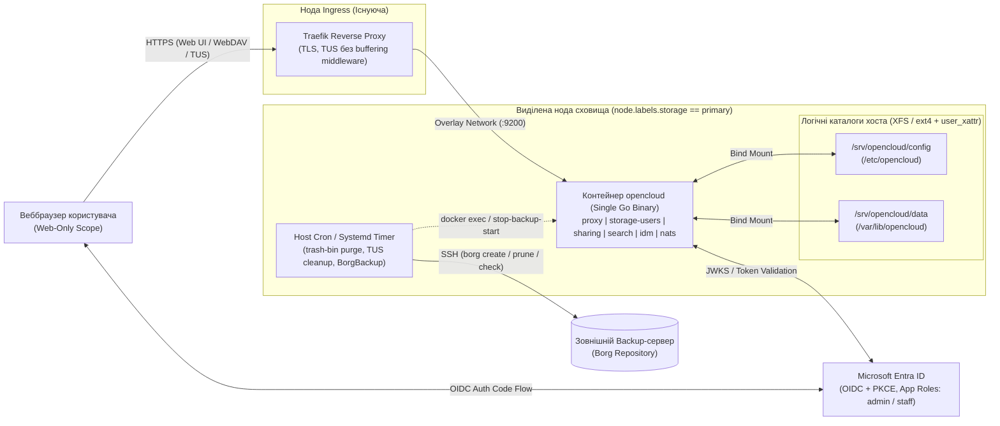

# Базова технічна специфікація (MVP): Корпоративне сховище OpenCloud (PosixFS)

## КРОК 1: Результати експрес-аудиту та архітектурні рішення

### 1. Ключові архітектурні принципи MVP

- **Повна ізоляція від Drupal 11 (Фаза 1):** Вебпортал розгортатиметься на наступному етапі на окремій ноді. У межах Фази 1 розгортається виключно сховище OpenCloud (один контейнер у Docker Swarm) без СУБД, Redis чи онлайн-редакторів.
- **KISS-підхід до файлової системи (`Non-Collaborative Mode`):** Ми не проєктуємо та не відтворюємо внутрішню структуру каталогів OpenCloud вручну. На хості виділяються два логічні каталоги (`/srv/opencloud/config` та `/srv/opencloud/data`), а OpenCloud самостійно керує внутрішньою ієрархією (`/var/lib/opencloud/storage/users`), індексами Bleve, LDAP-базою `idm` та кешем `nats-js-kv`. Режим `non-collaborative` є штатним і не потребує налаштування `inotify` чи додаткових системних ресурсів.
- **Жорсткий контроль доступу на рівні IdP:** Замість складної синхронізації сотень груп використовується точкове призначення прав у Spaces та фільтрація входу на рівні Microsoft Entra ID: доступ мають лише користувачі зі значенням `staff` у полі `companyName` (через App Role `staff`) та 1–2 адміністратори (App Role `admin`).

### 2. Головні технічні ризики та шляхи їх вирішення

1. **Пряма інтеграція OIDC з Microsoft Entra ID без Keycloak (PoC-ризик).** Офіційна документація OpenCloud містить приклади налаштування зовнішнього OIDC-провайдера для Keycloak, а для Entra ID існують особливості валідації токенів (випуск Access Token під MS Graph замість JWT без кастомного API scope) та формату UUID (`oid`, що починається з цифри).
    - *Рішення:* Винести верифікацію параметрів `PROXY_OIDC_ACCESS_TOKEN_VERIFY_METHOD`, `GRAPH_USERNAME_MATCH=none` та мапінгу ролей у обов'язковий етап PoC (Step 1) до відкриття доступу користувачам.
2. **Обмеження на мобільні та десктопні клієнти (Web-Only Scope).** Нативні клієнти OpenCloud використовують жорстко зашиті Client ID (`OpenCloudDesktop`, `OpenCloudAndroid`, `OpenCloudIOS`), тоді як Entra ID генерує випадкові GUID і не дозволяє задавати власні текстові Client ID.
    - *Рішення:* У межах Фази 1 підтримується виключно вебінтерфейс (`WEB_OIDC_CLIENT_ID`). За потреби підключення мобільних/десктопних клієнтів у майбутньому перед Entra ID встановлюється легкий OIDC-брокер (наприклад, Pocket ID або Keycloak).
3. **Неповний бекап стану або втрата `xattrs`.** При використанні `PosixFS` стан системи розподілений між файлами (`user.oc.*` у `xattrs`), внутрішньою LDAP-базою автопровіжених користувачів (`idm`), ID-кешем (`nats-js-kv`) та ключами в `/etc/opencloud`. Відновлення лише файлів без `idm` згенерує користувачам нові внутрішні ID, і старі ACL перестануть працювати.
    - *Рішення:* Бекапити обидва каталоги (`/srv/opencloud/data` та `/srv/opencloud/config`) виключно через `BorgBackup` на зовнішній сервер після зупинки сервісу.
4. **Накопичення сміття в кошику та незавершених TUS-завантаженнях.** Параметр зберігання кошика (720 годин) та перервані чанкові завантаження TUS не очищуються автоматично без запуску сервісних команд.
    - *Рішення:* Налаштувати регулярний `systemd timer` або `cron` на хості для виклику штатних CLI-команд очищення.

### 3. Рекомендовані скіли для ШІ-агента на етапі написання коду/конфігурацій

- **Docker Swarm & Traefik Ingress Engineer:** Підготовка `docker-stack.yml` (bind mounts, Swarm Secrets, `stop-first` оновлення) та налаштування маршрутизації без буферизації тіла запиту в Traefik.
- **Linux Storage & Backup Administrator:** Підготовка розділу XFS/ext4 (`user_xattr`), налаштування `BorgBackup` (ротація `prune`, перевірка `check`, зовнішній таргет) та `systemd timer` для регламентного очищення TUS/trash-bin.
- **OpenCloud & Entra ID IAM Specialist:** Налаштування App Registration у Microsoft Entra ID (App Roles `admin`/`staff`, PKCE, custom API scope) та конфігурація OIDC-змінних і `proxy.yaml` в OpenCloud.

---

## КРОК 2: Базова специфікація проєкту (System Specification)

### 1. Огляд та межі проєкту (Overview & Scope)

#### Суть та бізнес-ціль

Розгортання корпоративного файлового сховища університету на базі **OpenCloud (`PosixFS`)** на виділеній ноді кластера Docker Swarm. Система замінює Google Drive для персоналу університету (до 1 000 користувачів), забезпечуючи єдиний вхід через Microsoft Entra ID, спільні простори підрозділів (Spaces) та генерацію стабільних публічних HTTPS-посилань для подальшого використання на вебпорталі Drupal 11.

#### Ролі користувачів

- **Системний адміністратор (`Global Admin`):** Користувач із App Role `admin` в Entra ID. Створює спільні простори підрозділів (Spaces), встановлює квоти та призначає менеджерів просторів.
- **Керівник підрозділу (`Manager` у Space):** Призначає персональні права доступу співробітникам у межах свого Space, керує структурою папок та кошиком простору.
- **Співробітник університету (`Editor` / `Viewer` у Space):** Авторизований користувач (атрибут `companyName == "staff"` у MS 365 / App Role `staff`). Завантажує та оновлює файли (включно з файлами 10–50 ГБ), редагує `.md` нотатки, створює публічні посилання.
- **Зовнішній споживач (Анонімний користувач):** Переглядає або завантажує документи за публічними HTTPS-посиланнями (`/s/<token>`).

#### In Scope (MVP — Фаза 1: Сховище)

- Розгортання контейнера `opencloud` на виділеній ноді Docker Swarm за зовнішнім Ingress-проксі Traefik.
- Монтування двох логічних каталогів хоста: `/srv/opencloud/config` (`/etc/opencloud`) та `/srv/opencloud/data` (`/var/lib/opencloud`) на файловій системі XFS/ext4 з підтримкою `user_xattr` у стандартному режимі `non-collaborative`.
- OIDC-автентифікація через Microsoft Entra ID (Authorization Code Flow + PKCE) виключно для вебінтерфейсу:
    - Автоматичний провіжинінг користувачів при першому вході (JIT).
    - Призначення ролі `Global Admin` через App Role `admin` в Entra ID та мапінг ролей у `proxy.yaml`.
    - Допуск до системи лише співробітників із `companyName == "staff"` (через App Role `staff` в Entra ID) з автоматичним відхиленням інших облікових записів тенанту.
- Робота зі спільними просторами (`Spaces`), точкове призначення прав на осіб (`Manager`, `Editor`, `Viewer`), версіонування при перезаписі файлів та кошик на 30 днів (720 годин).
- Передача великих файлів (10–50 ГБ) за протоколом TUS.io.
- Генерація постійних публічних HTTPS-посилань на документи, придатних для подальшого використання на університетському порталі.
- Регламентне обслуговування (очищення кошика та прострочених TUS-сесій) і резервне копіювання повного стану через `BorgBackup` на зовнішній сервер.

#### Out of Scope (Поза межами Фази 1)

- Розгортання вебпорталу Drupal 11, СУБД MariaDB, Valkey та PHP-FPM (Фаза 2 на окремій ноді).
- Налаштування та тестування вбудовування документів через `<iframe>`, заголовків `Content-Security-Policy` (`csp.yaml`) та `X-Frame-Options` (перенесено у Фазу 2 під час інтеграції Drupal 11).
- Встановлення онлайн-редакторів Collabora Online або ONLYOFFICE Docs.
- Підтримка входу через OIDC у нативних мобільних (Android/iOS) та десктопних клієнтах OpenCloud (за потреби реалізується у Фазі 2 через OIDC-брокер).
- Синхронізація груп з Entra ID.

### 2. Функціональні вимоги та сценарії (Core Workflows)

#### Сценарій 1: Вхід через Microsoft Entra ID та розмежування прав (`admin` / `staff`)

1. Користувач відкриває вебінтерфейс сховища `[ASSUMPTION: <https://cloud.university.edu.ua>]` і проходить OIDC-автентифікацію в Microsoft Entra ID.
2. Entra ID перевіряє призначення App Roles (`admin` для адміністраторів або `staff` для співробітників із `companyName == "staff"`) та повертає токен.
3. Сервіс `proxy` в OpenCloud валідує токен і перевіряє клейм ролей:
    - Якщо роль `admin` — створює/оновлює користувача через JIT і надає права `Global Admin`.
    - Якщо роль `staff` — створює/оновлює користувача через JIT з базовою роллю `user`.
    - Якщо роль відсутня (наприклад, студент або зовнішній гість без `companyName == "staff"`) — OpenCloud блокує вхід із помилкою авторизації.
4. Керівник підрозділу (`Manager`) знаходить автопровіженого співробітника в інтерфейсі та надає йому персональний доступ (`Editor` або `Viewer`) до потрібного Space.

#### Сценарій 2: Завантаження та оновлення файлів зі збереженням публічного HTTPS-посилання

1. Користувач із роллю `Editor` завантажує документ або архів (10–50 ГБ) у спільний простір підрозділу (`Spaces`) за протоколом TUS.io.
2. Драйвер `PosixFS` зберігає файл у `/var/lib/opencloud/storage/users` та записує стабільний UUID у розширені атрибути `user.oc.*`.
3. Користувач створює публічне HTTPS-посилання (`/s/<token>`), яке залишається незмінним при перейменуванні файлу або завантаженні нової редакції поверх існуючого файлу.

#### Сценарій 3: Регламентне очищення, бекап та відновлення стану

1. **Планове очищення:** За розкладом (`systemd timer` / `cron`) на хості запускаються штатні команди:
    - видалення файлів із кошика, старших за 30 днів (720 годин);
    - очищення прострочених незавершених TUS-завантажень.
2. **Резервне копіювання:** Щоночі сервіс `opencloud` зупиняється, `BorgBackup` виконує інкрементальний бекап каталогів `/srv/opencloud/data` та `/srv/opencloud/config` на зовнішній сервер, виконує ротацію (`prune`) та запускає сервіс назад.
3. **Відновлення (Restore):** При потребі відновлення даних (навіть старших за 30 днів) адміністратор зупиняє контейнер `opencloud`, розгортає архів через `borg extract` (зі збереженням `xattrs`, LDAP-бази `idm` та `nats-js-kv`) і запускає контейнер — під час старту OpenCloud автоматично прогріває кеші та підхоплює всі дані.

#### Критерії прийняття (Acceptance Criteria)

- **AC-1 (OIDC SSO та фільтрація `staff`):** Співробітник із роллю `staff` (`companyName == "staff"`) успішно входить у вебінтерфейс через Entra ID без ручного створення акаунту; користувач тенанту без цієї ролі отримує відмову у вході.
- **AC-2 (Перший Global Admin):** Адміністратор із App Role `admin` в Entra ID після першого входу автоматично отримує права адміністратора в OpenCloud і може створювати Spaces.
- **AC-3 (Стабільність публічних HTTPS-посилань):** Публічне посилання (`/s/<token>`) на файл у Space залишається постійним і доступним по HTTPS після перейменування файлу або завантаження його нової версії.
- **AC-4 (TUS Resumable Upload):** Завантаження файлу розміром $\ge 10\text{ ГБ}$ успішно відновлюється після розриву з'єднання та завершується без помилок проксі-сервера.
- **AC-5 (Консистентність бекапу та відновлення):** Після відновлення `/srv/opencloud/data` та `/srv/opencloud/config` з архіву BorgBackup на чисту директорію зберігаються внутрішні ID користувачів, права доступу в Spaces та працездатність раніше створених публічних посилань.

#### Нефункціональні вимоги та очікуване навантаження

- **Масштаб першого року:** до 1 000 користувачів, \~100 директорій, до 1 000 файлів.
- **Продуктивність завантаження:** Файл обсягом $\ge 10\text{ ГБ}$ успішно завантажується за протоколом TUS.io без обривів сесії.
- **Чуйність інтерфейсу під навантаженням:** Вебінтерфейс OpenCloud відкривається та реагує на навігацію за час $\le 2\text{ с}$ під час 2 паралельних завантажень великих файлів.

### 3. Архітектура та технологічний стек

#### Технологічний стек ноди сховища

- **ОС хоста:** Linux (ядро 5.15+ / 6.x) з файловою системою **XFS** (пріоритетно, ліміт 64 КБ на `xattr`) або **ext4** (`user_xattr`).
- **Оркестрація:** Docker Swarm (виділена нода з міткою `node.labels.storage == primary`).
- **Ядро сховища:** Офіційний образ `opencloud` (гілка 7.2.x / 9.1.0+, єдиний бінарний процес мовою Go, що об'єднує `proxy`, `storage-users`, `sharing`, `search` на базі Bleve та `thumbnails`).
- **Драйвер зберігання:** `PosixFS` у стандартному режимі `non-collaborative` (без `STORAGE_USERS_POSIX_WATCH_FS`).
- **Ingress-маршрутизатор:** Центральний сервер Traefik кластера (термінація TLS, маршрутизація в overlay-мережу).
- **Провайдер ідентичності:** Microsoft Entra ID (безкоштовний базовий рівень, протокол OIDC).

#### Схема архітектури Фази 1



### 4. Модель даних та структура зберігання (Data Model)

#### 4.1. Логічна структура монтування на хості (KISS)

Замість ручного проєктування внутрішніх шляхів OpenCloud на хості створюються лише два кореневі каталоги, які монтуються в контейнер:

```
/srv/opencloud/
├── config/   -->  /etc/opencloud      (конфігураційні файли proxy.yaml, ключі підпису)
└── data/     -->  /var/lib/opencloud  (сховище PosixFS, індекс Bleve, LDAP idm, кеш nats-js-kv)
```

- Усередині `/var/lib/opencloud` OpenCloud самостійно формує стандартну структуру (зокрема `/var/lib/opencloud/storage/users` для файлів та метаданих у розширених атрибутах `user.oc.*`, `/var/lib/opencloud/storage/uploads` для TUS-чанків, `/var/lib/opencloud/idm` для профілів користувачів та `/var/lib/opencloud/nats` для ID-кешу).
- Оскільки при відновленні через `BorgBackup` архівуються обидва каталоги цілком, цілісність зв'язків між внутрішніми UUID користувачів в `idm` та записами в `xattrs` файлів гарантується автоматично.

### 5. API та сервісні контракти взаємодії

#### 5.1. Ключові інтерфейси OpenCloud

| Категорія | Метод / Інтерфейс | Шлях / Команда | Опис взаємодії |
| --- | --- | --- | --- |
| **OIDC Auth** | `GET` | `/.well-known/openid-configuration` | Конфігурація OIDC для узгодження токенів з Entra ID. |
| **WebDAV / Файли** | `PROPFIND, GET, PUT, MKCOL` | `/dav/spaces/<space-id>/<path>` | Управління файлами та метаданими у просторах. |
| **TUS Uploads** | `POST, HEAD, PATCH` | `/dav/spaces/<space-id>` | Чанкове завантаження файлів 10–50 ГБ із можливістю докачування. |
| **Public Shares** | `GET` | `/s/<public-token>` | Постійне публічне HTTPS-посилання на файл для перегляду та завантаження. |
| **Healthcheck** | `GET` | `/healthz` `[ASSUMPTION: порт 9200]` | Перевірка стану сервісу демоном Docker Swarm. |

#### 5.2. Регламентні CLI-команди обслуговування

Виконуються всередині контейнера (`docker exec <container> ...`):

- **Очищення кошика (поріг 720 годин / 30 днів):**`opencloud storage-users trash-bin purge-expired`
- **Очищення прострочених незавершених TUS-завантажень:**`opencloud storage-users uploads sessions --expired=true --clean`

### 6. Безпека та експлуатація (Security & Ops Baseline)

#### 6.1. Автентифікація та авторизація через Microsoft Entra ID

- **Параметри OIDC у контейнері OpenCloud:**
    - `OC_OIDC_ISSUER=https://login.microsoftonline.com/<TENANT_ID>/v2.0`
    - `PROXY_AUTOPROVISION_ACCOUNTS=true` (автоматичне створення профілів при першому вході).
    - `OC_EXCLUDE_RUN_SERVICES=idp` (вимкнення вбудованого IdP, використання лише Entra ID).
    - `GRAPH_USERNAME_MATCH=none` (обов'язково, щоб дозволити імена/ID, що починаються з цифри, як-от UUID `oid` в Entra ID).
    - `PROXY_ROLE_ASSIGNMENT_DRIVER=oidc` та `PROXY_ROLE_ASSIGNMENT_OIDC_CLAIM=roles` (мапінг ролей у файлі `proxy.yaml`).
    - `GRAPH_ASSIGN_DEFAULT_USER_ROLE=false` (заборона автоматичної видачі прав тим, у кого немає відповідної ролі в токені).
- **Конфігурація в Entra ID (Безкоштовний рівень):**
    1. У App Registration створюються дві App Roles: `admin` (призначається 1–2 глобальним адміністраторам) та `staff` (призначається користувачам, у яких в профілі MS 365 заповнено `companyName == "staff"`).
    2. У `proxy.yaml` задається відповідність: значення `admin` $\rightarrow$ роль OpenCloud `admin`; значення `staff` $\rightarrow$ роль OpenCloud `user`. Будь-який користувач без ролі `admin` чи `staff` у токені відхиляється сервісом `proxy` при спробі входу.

#### 6.2. Управління конфігурацією та секретами

- Усі чутливі параметри (секрети підпису токенів, ключі шифрування сесій) передаються через **Docker Swarm Secrets** (`/run/secrets/<secret_name>`).
- Конфігурація мапінгу ролей зберігається у `/srv/opencloud/config/proxy.yaml` під контролем версій (без секретів усередині).

#### 6.3. Ресурси ноди, Docker Swarm та Traefik

- **Ресурси виділеної ноди сховища (для 1 000 користувачів):**
    - **CPU:** `2 vCPU` (цільовий production).
    - **RAM:** `8 ГБ` для цільового production (за офіційними рекомендаціями OpenCloud для 1 000 користувачів). *Для початкового пілоту допускається старт на 4 ГБ RAM без жорсткого ліміту пам'яті контейнера (`memory limit`) до проведення навантажувального тестування.*
    - **Storage:** За фактичним обсягом даних (`/srv/opencloud/data` на розділі XFS або ext4 з `user_xattr`).
    - **Масштабування та репліки:** `replicas: 1` (вертикальне масштабування).
- **Політики Docker Swarm (`docker-stack.yml`):**
    - `placement.constraints`: `[node.labels.storage == primary]`
    - `update_config`: `parallelism: 1`, `order: stop-first`, `failure_action: rollback`, `delay: 10s`
    - `restart_policy`: `condition: on-failure`, `delay: 5s`, `max_attempts: 5`
- **Вимоги до центрального Traefik:**
    - На роутері OpenCloud має бути відсутній `buffering` middleware, щоб чанки протоколу TUS передавалися потоково.
    - Налаштування `respondingTimeouts` залишаються помірними на рівні entrypoint (без встановлення `readTimeout = 0`, оскільки TUS передає дані невеликими чанками).

#### 6.4. Резервне копіювання та обслуговування (`BorgBackup`)

- **Єдиний інструмент бекапу:** `BorgBackup` (підтримує збереження `xattrs`, ACL та дедуплікацію).
- **Цільове сховище бекапів (`<backup-target>`):** Зовнішній виділений backup-сервер по SSH (поза межами цієї ноди).
- **Процедура нічного бекапу:**
    1. Зупинка сервісу OpenCloud (`docker service scale <stack>_opencloud=0`) для гарантованої консистентності `idm`, `nats-js-kv` та `xattrs`.
    2. Створення архіву `borg create` для обох директорій: `/srv/opencloud/data` та `/srv/opencloud/config`.
    3. Запуск сервісу (`docker service scale <stack>_opencloud=1`).
    4. Ротація архівів: `borg prune --keep-daily=7 --keep-weekly=4 --keep-monthly=6` та `borg compact`.
    5. Щотижнева перевірка цілісності репозиторію: `borg check`.
- **Регламентне обслуговування (`systemd timer` / `cron`):** Щоденний запуск команд `trash-bin purge-expired` та `uploads sessions --expired=true --clean`.

### 7. План подальшої документації та старт (PoC Checklist)

#### Артефакти для переходу до імплементації

1. `scripts/host-prepare.sh` — підготовка директорій `/srv/opencloud/{config,data}`, перевірка підтримки `user_xattr` на файловій системі, встановлення мітки `storage=primary` у Swarm.
2. `docker-stack.yml` + `config/proxy.yaml` — маніфест розгортання OpenCloud у Docker Swarm із налаштуваннями OIDC Entra ID, ролями `admin`/`staff`, Swarm Secrets та лейблами Traefik.
3. `scripts/maintenance-and-backup.sh` + `systemd` юніти — автоматизація `BorgBackup` на зовнішній сервер (`create`, `prune`, `check`) та регулярне очищення кошика і прострочених TUS-завантажень.

#### Рекомендований перший крок (Step 1: PoC-верифікація Entra ID + PosixFS)

Перед переходом у продакшен розгорнути тестовий стенд за `docker-stack.yml` та перевірити 4 критичні гіпотези прямої інтеграції з Microsoft Entra ID:

1. **Верифікація Access Token:** Перевірити роботу `PROXY_OIDC_ACCESS_TOKEN_VERIFY_METHOD` та `OC_OIDC_ISSUER` з Entra ID (за потреби створити власний API scope в App Registration, щоб Entra видавала валідний JWT замість непрозорого токена MS Graph).
2. **Мапінг ідентифікатора користувача:** Перевірити зв'язку `PROXY_USER_OIDC_CLAIM` (наприклад, `oid` або `preferred_username`) та `PROXY_USER_CS3_CLAIM` за наявності `GRAPH_USERNAME_MATCH=none` (оскільки `oid` часто починається з цифри).
3. **Мапінг ролей (`admin` та `staff`):** Переконатися, що користувач із App Role `admin` отримує права адміністратора, користувач із App Role `staff` — права звичайного користувача, а користувач без жодної з цих ролей отримує відмову при вході.
4. **Перевірка `PosixFS` та бекапу:** Завантажити файл $\ge 10\text{ ГБ}$ через TUS, перевірити створення атрибутів `user.oc.*` у `/srv/opencloud/data` та виконати тестовий цикл `borg create` $\rightarrow$ `borg extract`.